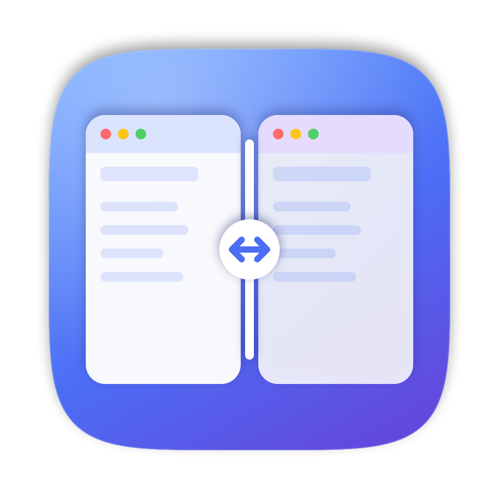

<p align="center">
  
</p>

<h1 align="center">PaneFlow</h1>

<p align="center">
  Gerenciador de janelas nativo para macOS inspirado no Snap Assist do Windows 11.<br>
  <em>A native macOS window manager inspired by Windows 11 Snap Assist.</em>
</p>

---

Arraste uma janela até a borda da tela e ela ocupa metade dela; no espaço que sobra, o PaneFlow
mostra as outras janelas abertas para você escolher qual vai ao lado. Depois, arraste a divisa entre
as duas para ajustar a proporção — a vizinha acompanha.

Escrito em Swift 6 com AppKit, SwiftUI, Accessibility API e ScreenCaptureKit. **Sem APIs privadas,
sem dependências externas, sem nenhum acesso à internet.**

> **Estado: 0.3.5 — em desenvolvimento.** Funciona e está coberto por testes, mas ainda não teve
> uso prolongado. Não há binário assinado/notarizado: é preciso compilar a partir do código.

## Recursos

- **Encaixe ao arrastar** — bordas esquerda/direita (metades), cantos (quartos), borda superior
  (maximizar na área útil, sem tela cheia), com prévia translúcida. `Esc` cancela; segurar `⌥` desliga.
- **Snap Assist** — após encaixar, a área vazia mostra as outras janelas (miniaturas reais com a
  permissão de Gravação de Tela; ícone e título sem ela). Escolha com o mouse, setas + `↩`, ou
  digitando parte do nome. A janela escolhida preenche **exatamente** o espaço restante.
- **Redimensionamento conjunto** — arraste a divisa entre janelas lado a lado (ou em grade) e as
  vizinhas acompanham ao vivo, respeitando o tamanho mínimo de cada app.
- **Vários monitores** — coordenadas negativas, escalas diferentes e **resistência na divisa** entre
  monitores: o cursor para na borda compartilhada para você encaixar; continue empurrando para
  passar ao outro monitor.
- **Inverter janelas** — troca esquerda ↔ direita mantendo as proporções (menu ou `⌃⌥S`).
- **Atalhos** — `⌃⌥←/→` metades (repita para trocar de monitor), `⌃⌥↑` maximizar, `⌃⌥↓` restaurar,
  `⌃⌥C` centralizar, `⌃⌥↩` próximo monitor.
- Interface em português, modo claro/escuro, Reduzir Movimento respeitado.

## Requisitos

- macOS 14 (Sonoma) ou posterior — desenvolvido e testado em macOS 27, Apple Silicon.
- Xcode 16 ou posterior (Swift 6).

## Instalação a partir do código

```bash
git clone https://github.com/bruno-acr/PaneFlow.git
cd PaneFlow
./scripts/install.sh
open /Applications/PaneFlow.app
```

O PaneFlow aparece na barra de menus e abre a janela de permissões:

| Permissão | Para quê | Obrigatória |
|---|---|---|
| Acessibilidade | Ler a posição/tamanho das janelas de outros apps e movê-las. Nunca lê nem altera conteúdo. | Sim |
| Gravação de Tela | Miniaturas no Snap Assist, capturadas sob demanda e mantidas só em memória. | Não |

Monitoramento de Entrada **não** é necessário.

> **Desative outros encaixes** que reagem ao mesmo gesto: Ajustes do Sistema › Mesa e Dock ›
> Janelas ("Arrastar janelas para as bordas…") e apps como Rectangle ou Magnet. O PaneFlow avisa no
> menu quando detecta um deles.

> **Assinatura local:** o build usa assinatura ad-hoc, e o macOS vincula a permissão à assinatura.
> Após cada reinstalação rode `tccutil reset Accessibility app.paneflow.PaneFlow` e conceda de novo,
> ou defina `PANEFLOW_SIGN_IDENTITY` com um certificado seu (veja [DEVELOPMENT.md](DEVELOPMENT.md)).

## Privacidade

- Nenhum código de rede: nada sai do seu Mac.
- Miniaturas só em memória, descartadas ao fechar o painel; nunca gravadas em disco.
- Títulos de janelas nunca vão para os logs; o relatório de diagnóstico é sanitizado e só é gerado
  quando você pede.

## Desenvolvimento

```bash
./scripts/test.sh        # 118 testes unitários e de integração
./scripts/self-test.sh   # move janelas reais (Safari + Word) e verifica a geometria
./scripts/drag-test.sh   # arraste ponta a ponta com eventos de mouse sintéticos
```

Arquitetura em três módulos: `PaneFlowCore` (decisões puras e testáveis: geometria, zonas, máquina
de estados, layouts), `PaneFlowSystem` (Accessibility, window server, ScreenCaptureKit) e `PaneFlow`
(app da barra de menus).

[Arquitetura](ARCHITECTURE.md) · [Desenvolvimento](DEVELOPMENT.md) · [Testes](TESTING.md) ·
[Limitações conhecidas](KNOWN_LIMITATIONS.md) · [Desempenho](PERFORMANCE.md) ·
[Compatibilidade](COMPATIBILITY.md) · [Release](RELEASE.md) · [Changelog](CHANGELOG.md) ·
[Progresso](PROGRESS.md)

## Licença

[MIT](LICENSE). Projeto independente; não afiliado à Apple nem à Microsoft. "Windows" e "Snap
Assist" são marcas da Microsoft, citadas apenas como referência de comportamento.
